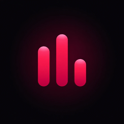
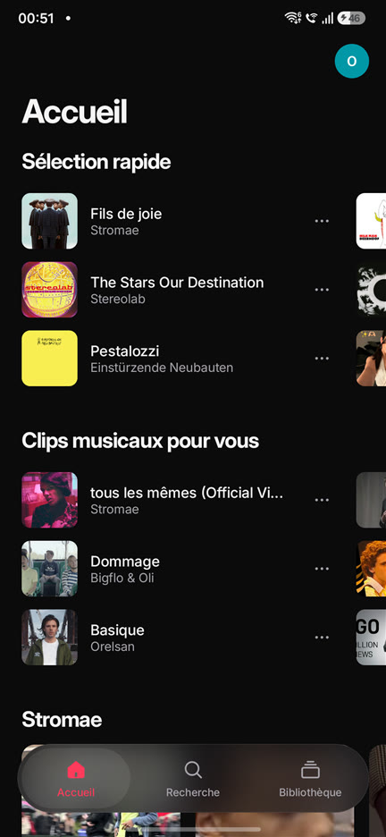
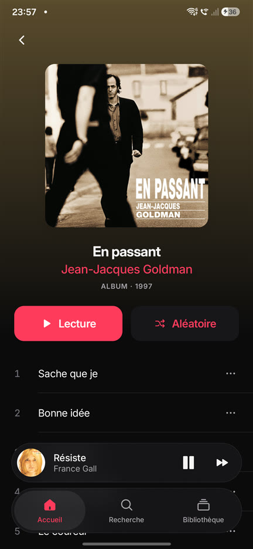
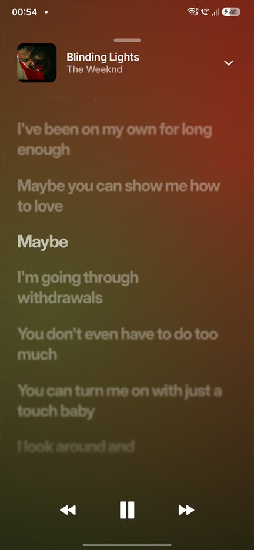
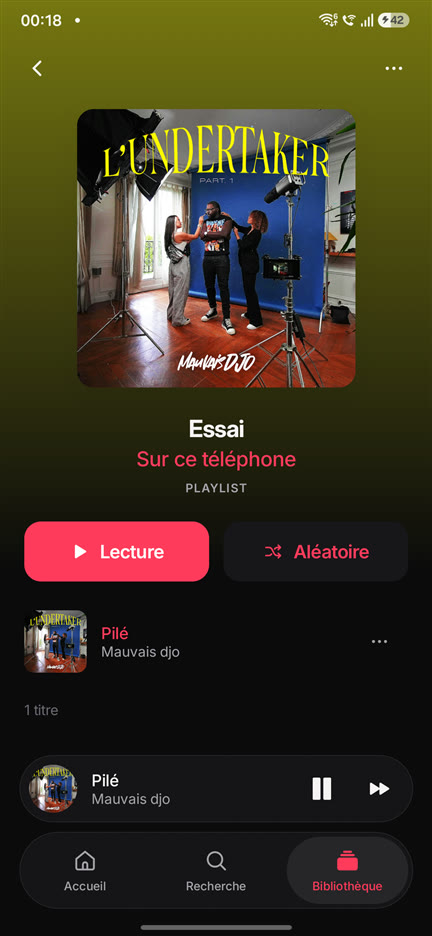
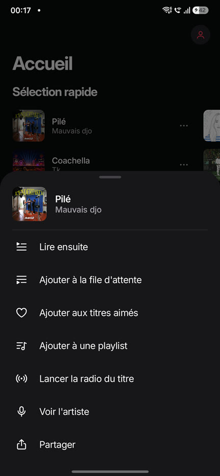

<p align="center">
  
</p>

<h1 align="center">AM Music</h1>

<p align="center">
  <b>YouTube Music sur Android, en mieux rangé.</b><br>
  Audio seul, sans publicité, avec des paroles qui suivent la musique.
</p>

<p align="center">
  Android 9 et plus · Kotlin · Jetpack Compose · Licence GPL-3.0
</p>

<p align="center">
  
  
  
  
  
</p>

## En deux mots

AM Music est un lecteur de musique pour Android qui puise dans le catalogue de YouTube Music.
Il ne lit que le son : pas de vidéo, pas de publicité, et la musique continue écran éteint.
Tout le reste est fait maison : une interface sombre et épurée, un seul accent de couleur,
des animations à ressort partout, et un lecteur dont les couleurs suivent la pochette.

C'est un projet personnel, fait pour le plaisir d'avoir une appli de musique agréable à ouvrir.

## Ce que l'appli sait faire

**Écouter**
- Lecture en arrière-plan, commandes dans la notification, sur l'écran verrouillé et depuis les écouteurs Bluetooth.
- Radio sans fin : lancez un titre, la suite arrive toute seule.
- File d'attente : glisser pour réordonner, balayer pour retirer, « lire ensuite ».
- Aléatoire, répétition, lecture d'un album ou d'une playlist en entier.

**Découvrir**
- Accueil avec recommandations, nouveautés, humeurs et genres.
- Recherche avec suggestions, filtres (titres, albums, artistes, playlists, clips) et historique.
- Pages artiste, album et playlist ; la pochette glisse de la liste vers la page.

**Chanter**
- Paroles synchronisées en plein écran, mot à mot quand elles existent.
- La ligne chantée est nette, les autres s'estompent. Touchez une ligne pour y aller.

**Garder**
- Bibliothèque : titres aimés, playlists, albums, artistes suivis, historique.
- Tout fonctionne **sans compte**. La connexion à votre compte YouTube Music est facultative :
  elle ajoute vos recommandations et votre bibliothèque.

**Soigner les détails**
- Mini-lecteur qui s'agrandit en lecteur plein écran en suivant le doigt.
- Thème sombre ou clair, couleur d'accent au choix.
- Chargements en squelettes animés, jamais de rond qui tourne.

## Confidentialité et sécurité

Cette partie est volontairement précise : vous pouvez tout vérifier dans le code.

- **Aucune publicité, aucun traceur, aucune statistique d'usage.** Le projet n'embarque aucune librairie de ce type.
- **Aucun serveur à nous.** L'appli ne parle qu'à :
  - YouTube et YouTube Music, pour le catalogue et le son ;
  - [LRCLIB](https://lrclib.net), LyricsPlus et BetterLyrics, pour les paroles (elle leur envoie le titre, l'artiste, l'album et la durée du morceau) ;
  - Google, uniquement si vous choisissez de vous connecter.
- **Votre mot de passe ne passe jamais par l'appli.** La connexion se fait sur la page officielle de Google, affichée dans une fenêtre web.
  L'appli récupère ensuite la session de YouTube Music, l'enregistre **chiffrée** (AES-GCM, clé gardée par l'Android Keystore) et ne l'envoie nulle part ailleurs qu'à YouTube.
  « Se déconnecter » efface la session et les cookies.
- **Peu d'autorisations** : Internet, notifications et lecture en arrière-plan. Pas d'accès aux contacts, au micro, à la position ni à vos fichiers.
- **Pas de sauvegarde dans le cloud** des données de l'appli (`allowBackup` désactivé).
- **Code ouvert**, sous licence libre. Le fichier d'installation proposé est compilé à partir de ce code, sans rien de plus ; vous pouvez aussi le compiler vous-même.

### À savoir avant d'installer

AM Music est un projet **non officiel**, sans aucun lien avec YouTube ni Google. Il s'appuie sur le fonctionnement interne de YouTube Music,
qui change régulièrement : la lecture peut casser du jour au lendemain (voir [MAINTENANCE.md](MAINTENANCE.md)).
L'utilisation de lecteurs tiers peut être contraire aux conditions d'utilisation de YouTube ; vous l'utilisez sous votre responsabilité,
en particulier si vous y connectez votre compte.

## Installer

**Le plus simple** : téléchargez le fichier `.apk` de la [dernière version](https://github.com/mochiiwuff/am-music/releases/latest) sur votre téléphone et ouvrez-le.
Android demandera d'autoriser l'installation depuis cette source : c'est normal pour une appli hors Play Store.
Chaque version indique l'empreinte SHA-256 de son fichier, pour vérifier qu'il n'a pas été modifié.

**En compilant vous-même** : il faut un ordinateur avec le JDK 17 et le SDK Android, et un téléphone sous Android 9 ou plus avec le débogage USB activé.

```bash
git clone https://github.com/mochiiwuff/am-music.git
cd am-music
./gradlew :app:assembleDebug
adb install -r app/build/outputs/apk/debug/app-debug.apk
```

## Où en est le projet

| | |
|---|---|
| Fondations, thème, navigation | Fait |
| Moteur YouTube Music, lecture en arrière-plan | Fait |
| Lecteur plein écran, file d'attente | Fait |
| Recherche, pages artiste / album / playlist | Fait |
| Compte et bibliothèque | Fait |
| Paroles synchronisées | Fait |
| SponsorBlock, écoute hors ligne, réglages audio, minuteur de sommeil | À venir |
| Finitions : écran de démarrage, widget, fichier d'installation signé | À venir |

## Sous le capot

- **Interface** : Jetpack Compose sans Material, composants et jeu d'icônes faits maison, police Inter, flou d'arrière-plan avec Haze.
- **Lecture** : Media3 (ExoPlayer et `MediaSessionService`), cache audio sur le téléphone.
- **Données** : Room pour la bibliothèque, Hilt pour l'injection, coroutines et Flow.
- **YouTube** : tout ce qui parle à YouTube vit dans le module `youtube`, pour le réparer vite quand quelque chose change.
  Deux méthodes d'accès au son s'enchaînent automatiquement si la première échoue. Les détails sont dans [docs/youtube.md](docs/youtube.md).

## Remerciements

AM Music existe grâce au travail de projets libres :

- [Metrolist](https://github.com/MetrolistGroup/Metrolist) et sa librairie innertubex : le module `youtube` reprend leur code d'accès à YouTube Music (dossier `com/metrolist`, GPL-3.0).
- [SimpMusic](https://github.com/maxrave-dev/SimpMusic), pour ses méthodes de secours.
- [NewPipeExtractor](https://github.com/TeamNewPipe/NewPipeExtractor), utilisé en solution de repli.
- LRCLIB, LyricsPlus et BetterLyrics, pour les paroles.
- [Inter](https://rsms.me/inter/), Haze, Coil, Media3 et Reorderable.

## Licence

[GPL-3.0](LICENSE). Vous pouvez utiliser, étudier, modifier et redistribuer ce code, à condition de garder la même licence.
