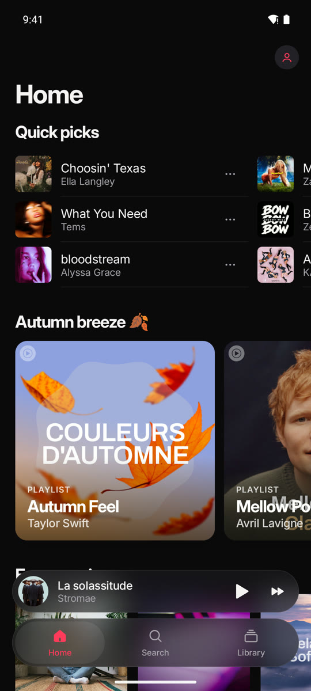
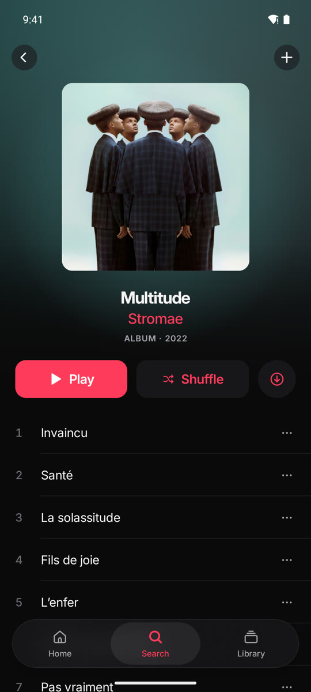
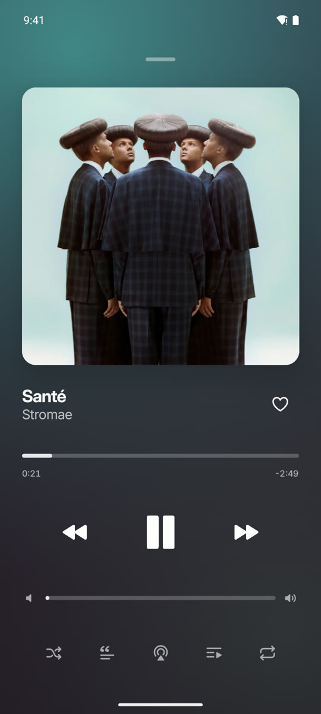
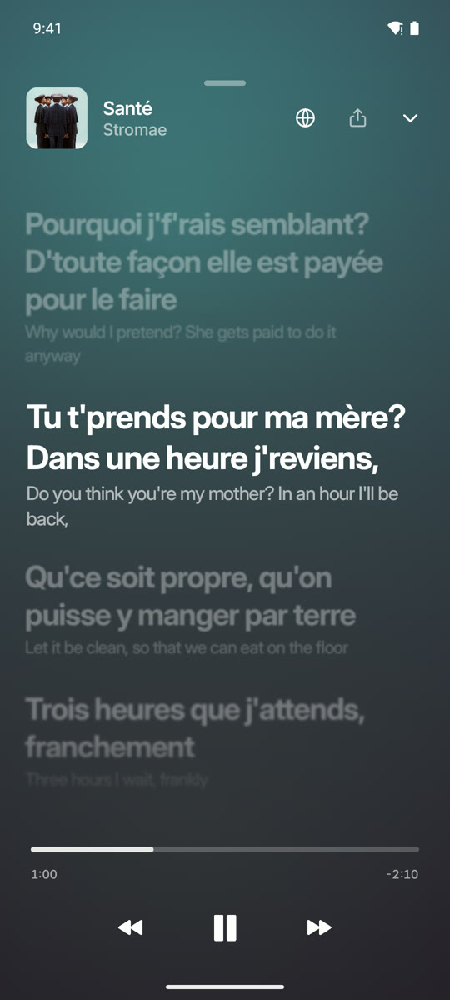
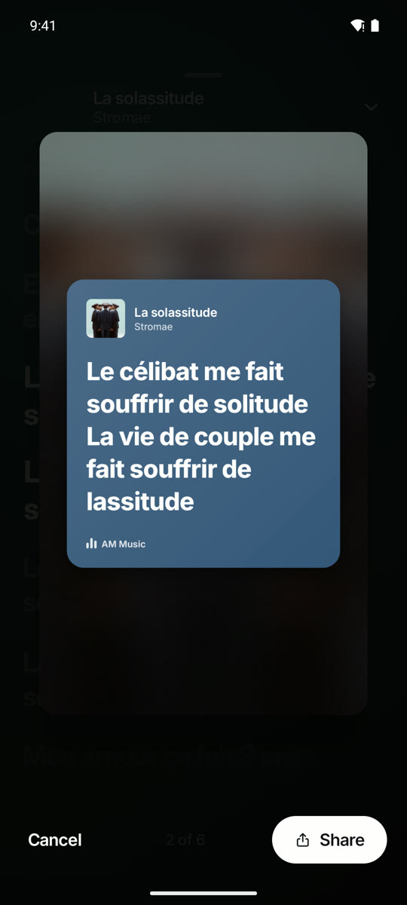
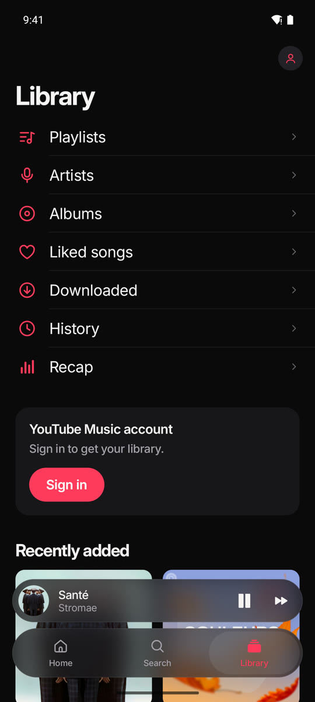
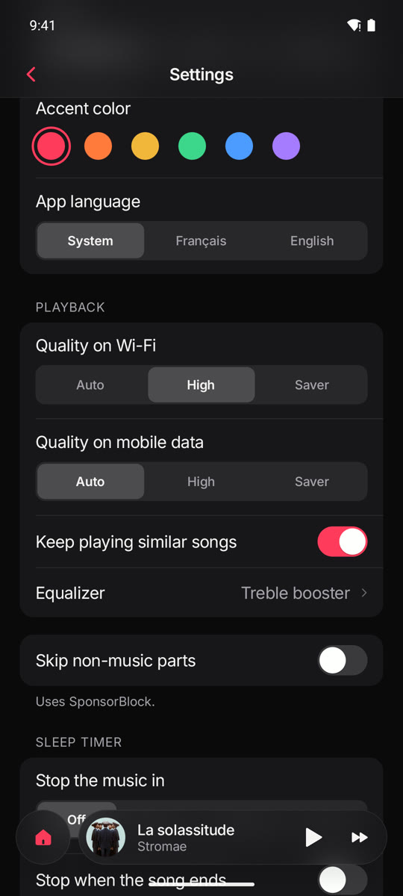
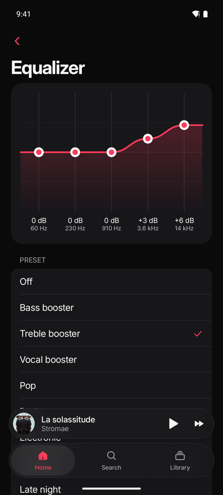

# AM Music

Unofficial YouTube Music client for Android. It plays audio only, has no ads, and shows synced lyrics.

I made it for myself because I wanted a music app that is pleasant to open. The interface is written from scratch in Compose (no Material components) and borrows a lot from Apple Music.

Requires Android 9 or newer.

<p>
  
  
  
  
</p>
<p>
  
  
  
  
</p>

## What it does

- Background playback with notification, lock screen and headset controls
- Endless radio after a song, queue with reorder / swipe to remove / play next
- Home feed, search with filters and history, artist, album and playlist pages
- Synced lyrics, word by word when a source has them
- Library: liked songs, playlists, albums, followed artists, history
- Works without an account. Signing in to YouTube Music is optional and brings your library and recommendations
- Downloads for offline listening (songs, albums, playlists), optionally on Wi-Fi only
- The queue and position are kept when the app is closed
- Reorder your playlists, also on your YouTube Music account
- Home screen widget and Android Auto support
- Monthly and yearly listening recap, built from your local history
- Share a few lines of lyrics as an image, or show a translation under each line
- Settings: audio quality on Wi-Fi and mobile data, equalizer, sleep timer, cache size, optional SponsorBlock, light and dark theme, French and English

## Install

Download the APK from the [releases](https://github.com/mochiiwuff/am-music/releases) page and open it on your phone. Each release lists the SHA-256 of the file.

Android Auto only lists apps installed from the Play Store, unless "Unknown sources" is turned on in the Android Auto developer settings.

To build it yourself you need JDK 17 and the Android SDK:

```bash
git clone https://github.com/mochiiwuff/am-music.git
cd am-music
./gradlew :app:assembleDebug
adb install -r app/build/outputs/apk/debug/app-debug.apk
```

## Privacy

There are no ads, no analytics and no server of mine. The app only talks to:

- YouTube and YouTube Music, for the catalogue and the audio
- [LRCLIB](https://lrclib.net), LyricsPlus and BetterLyrics, for lyrics (they receive the title, artist, album and duration)
- [SponsorBlock](https://sponsor.ajay.app), only if you turn on "Skip non-music parts" (it receives the first 4 characters of a hash of the video id)
- Google Translate, only when you turn on lyrics translation (it receives the lyrics of the current song)
- Google, only if you sign in

Sign-in happens on Google's own page inside a WebView, so the app never sees your password. The resulting session is stored encrypted (AES-GCM, key in the Android Keystore) and is only sent to YouTube. Signing out deletes it. Android backups are disabled for the app.

## Disclaimer

This project is not affiliated with YouTube or Google. It relies on the internal API of YouTube Music, which changes often, so playback can break at any time (see [MAINTENANCE.md](MAINTENANCE.md)). Third-party clients may be against YouTube's terms of service. Use it at your own risk, especially with your account signed in.

## Code layout

- `app`: UI (Compose), playback (Media3 ExoPlayer and a `MediaSessionService`), library (Room), dependency injection (Hilt)
- `youtube`: everything that talks to YouTube, behind a single entry point, so it can be fixed quickly when something changes. Notes are in [docs/youtube.md](docs/youtube.md)

## Credits

- [Metrolist](https://github.com/MetrolistGroup/Metrolist) and its innertubex library. The `youtube` module includes their YouTube Music code (`com/metrolist`, GPL-3.0)
- [SimpMusic](https://github.com/maxrave-dev/SimpMusic) for its fallback approach
- [NewPipeExtractor](https://github.com/TeamNewPipe/NewPipeExtractor), used as a fallback
- LRCLIB, LyricsPlus, BetterLyrics and SponsorBlock
- [Inter](https://rsms.me/inter/), Haze, Coil, Media3, Reorderable

## License

[GPL-3.0](LICENSE)
